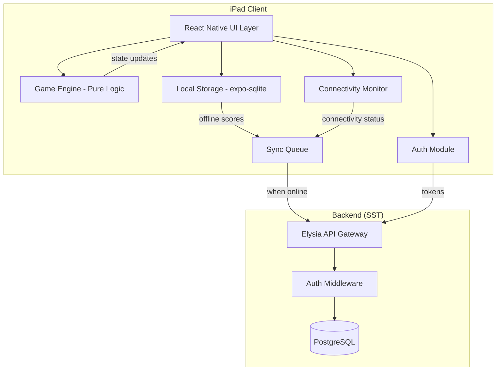
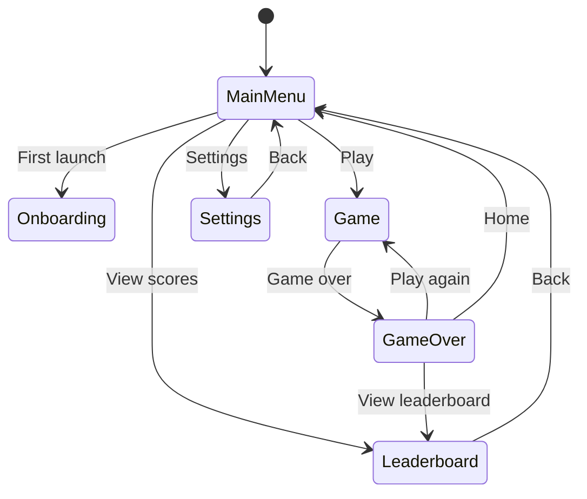

# Design Document: Spriggle iPad Game

## Overview

Spriggle is an iPad-only landscape match-3 gardening game built with React Native (Expo 55). The architecture separates concerns into three layers:

1. **Game Engine** — Pure TypeScript logic (board state, move validation, scoring, game-over detection) with no framework dependencies, enabling isolated testing
2. **Client Application** — Expo + React Native UI layer with Tamagui components, SVG plant rendering, offline-first data persistence, and multi-provider authentication
3. **Backend API** — Standalone SST-deployed service with Elysia handlers, Drizzle ORM, and PostgreSQL for global leaderboard and user profiles

The game engine is intentionally decoupled from the UI layer so that all game logic can be unit-tested and property-tested without rendering components.

## Architecture



### Layer Responsibilities

**Game Engine (Pure TypeScript)**

- Board initialization, validation, and state transitions
- Connected group detection (BFS/flood-fill)
- Move validation (dig eligibility, swap adjacency)
- Score calculation
- Game-over detection
- Serialization/deserialization of game state

**Client Application (Expo/React Native)**

- Screen navigation (Main Menu, Game, Game Over, Leaderboard, Onboarding)
- SVG plant rendering with accessibility attributes
- Touch input handling and gesture mapping to game actions
- Animation orchestration (dig, swap, refill)
- Local persistence (expo-sqlite for leaderboard, AsyncStorage for preferences)
- Sync queue management
- Authentication flow coordination
- Connectivity detection

**Backend API (SST/Elysia)**

- Score submission endpoint (authenticated, rate-limited)
- Global leaderboard retrieval
- User profile management
- JWT verification for multiple auth providers
- Database schema and migrations (Drizzle ORM)

## Components and Interfaces

### Game Engine Module

```typescript
// types.ts
type PlantType = "watermelon" | "flower" | "aubergine" | "tomato" | "pumpkin";
type Cell = PlantType | null;
type Board = Cell[][]; // 8×8 grid, board[row][col]
type Position = { row: number; col: number };

interface GameState {
  board: Board;
  score: number;
  turns: number;
  isGameOver: boolean;
}

interface DigResult {
  success: boolean;
  newState: GameState;
  removedPositions: Position[];
  refillPositions: Position[];
}

interface SwapResult {
  success: boolean;
  newState: GameState;
  refillPositions: Position[];
}

// engine.ts - Pure functions, no side effects
interface GameEngine {
  initializeBoard(): GameState;
  findConnectedGroup(board: Board, position: Position): Position[];
  findAllConnectedGroups(board: Board): Position[][];
  isValidDig(board: Board, position: Position): boolean;
  executeDig(state: GameState, position: Position): DigResult;
  isValidSwap(board: Board, pos1: Position, pos2: Position): boolean;
  executeSwap(state: GameState, pos1: Position, pos2: Position): SwapResult;
  refillBoard(
    board: Board,
    count: number,
  ): { board: Board; filledPositions: Position[] };
  isGameOver(board: Board): boolean;
  calculateDigScore(plantType: PlantType, plantCount: number): number;
  serializeState(state: GameState): string;
  deserializeState(json: string): GameState;
}
```

### Local Storage Module

```typescript
interface LocalLeaderboardEntry {
  id: string;
  score: number;
  playerName: string;
  date: string; // ISO 8601
}

interface SyncQueueEntry {
  id: string;
  score: number;
  playerName: string;
  date: string;
  authToken: string;
  retryCount: number;
}

interface LocalStorageService {
  saveScore(entry: LocalLeaderboardEntry): Promise<void>;
  getLeaderboard(): Promise<LocalLeaderboardEntry[]>;
  saveGameState(state: PersistedGameState): Promise<void>;
  loadGameState(): Promise<PersistedGameState | null>;
  clearGameState(): Promise<void>;
  enqueueSyncEntry(entry: SyncQueueEntry): Promise<void>;
  getSyncQueue(): Promise<SyncQueueEntry[]>;
  removeSyncEntry(id: string): Promise<void>;
  // Increments a queued entry's retry counter after a 5xx submission failure
  // (Requirement 13.4). Added in Task 17.
  incrementSyncRetry(id: string): Promise<void>;
}

// The client persists a serializable snapshot of the in-progress game. Its
// shape mirrors the engine's GameState; it is declared locally in the mobile
// package (PersistedGameState) because the mobile app does not depend on the
// engine package directly.
interface PersistedGameState {
  board: (PlantType | null)[][];
  score: number;
  turns: number;
  isGameOver: boolean;
}
```

### Auth Module

```typescript
type AuthProvider = "apple" | "gamecenter" | "facebook" | "email" | "guest";

interface AuthUser {
  id: string;
  provider: AuthProvider;
  displayName: string;
  token: string | null; // null for guest
}

interface AuthService {
  signInWithApple(): Promise<AuthUser>;
  signInWithGameCenter(): Promise<AuthUser>;
  signInWithEmail(email: string, password: string): Promise<AuthUser>;
  playAsGuest(): AuthUser;
  signOut(): Promise<void>;
  getCurrentUser(): AuthUser | null;
  isAuthenticated(): boolean;
  // Rehydrates a persisted session on app start (secure store). Returns the
  // restored user or null. Added in Task 15 for relaunch continuity.
  restore(): Promise<AuthUser | null>;
}

// Guest-mode access policy (Requirement 10.6), shared by screens and the sync
// service so there is a single source of truth (validated by Property 25).
// Global access (view + submit) requires a non-guest identity AND a
// backend-verifiable token, so token-less providers (Game Center, until Task
// 18.2) are local-only.
type LeaderboardScope = "local" | "global";
function isGuest(user: AuthUser | null): boolean;
function availableLeaderboards(user: AuthUser | null): LeaderboardScope[];
function canSubmitGlobalScore(user: AuthUser | null): boolean; // non-guest + token
function canViewGlobalLeaderboard(user: AuthUser | null): boolean; // non-guest + token
```

**Provider implementation notes (Task 15):**

- **Apple** — `expo-apple-authentication`; the `identityToken` (a JWT) is the
  backend-verifiable token.
- **Facebook** — **deferred (not in MVP).** `"facebook"` remains a valid
  `AuthProvider` value for the backend user model and future support, but there
  is no client sign-in path; users who would use Facebook play as a guest.
- **Email/Password** — authenticates against Supabase Auth (GoTrue REST
  `/auth/v1/token`) via fetch. The returned Supabase JWT is verified by the
  existing `supabaseAuth.ts` JWKS verifier in `packages/api-utils`, which is why
  email uses Supabase rather than a bespoke endpoint.
- **Game Center** — `expo-game-center` (community; config-plugin adds the
  `com.apple.developer.game-center` entitlement at prebuild). Provides real
  client-side sign-in (`playerID`, `displayName`) but **not** GameKit's
  identity-verification signature, so it carries a `null` token. Game Center
  users are therefore local-only until Task 18.2 decides server-side
  verification (extend the native module to surface
  `fetchItems(forIdentityVerificationSignature:)`, or bind the GC identity to an
  Apple/Supabase token). Tokens are persisted with `expo-secure-store`.

### Sync Service

```typescript
interface SyncService {
  processQueue(): Promise<void>;
  submitScore(entry: SyncQueueEntry): Promise<boolean>;
  // Enqueue a score then best-effort drain (offline-first producer, 13.1).
  queueScore(entry: SyncQueueEntry): Promise<void>;
  onConnectivityChange(isConnected: boolean): void;
}
```

**Behaviour (Task 17):** `queueScore` persists the entry to sync_queue and
kicks a best-effort drain — it uploads immediately when online, otherwise the
entry stays queued for the next reconnect (Requirement 13.1). The game-over
screen calls it for authenticated players; guests are local-only.
`submitScore` POSTs to `POST /api/scores` with the
entry's `authToken` as a bearer token; it returns `true` on 2xx (persisted),
`false` on 4xx (client error), and throws on 5xx / network failure.
`processQueue` drains the sync_queue applying the design.md error policy per
entry — remove on 2xx (Property 21) or 4xx (drop, won't succeed on retry), and
retain + `incrementSyncRetry` on 5xx / network error (Property 22). Concurrent
`processQueue` calls coalesce into one in-flight drain. `onConnectivityChange`
triggers a drain when connectivity is regained; `startConnectivitySync` wires
`@react-native-community/netinfo` to it.

### Backend API Endpoints

```typescript
// POST /api/scores - Submit a score
interface SubmitScoreRequest {
  score: number;
  date: string;
}

// GET /api/leaderboard - Get global leaderboard
interface LeaderboardResponse {
  entries: {
    position: number;
    score: number;
    playerName: string;
    date: string;
  }[];
}

// GET /api/profile - Get player profile
interface ProfileResponse {
  id: string;
  displayName: string;
  bestScore: number;
  totalGames: number;
}
```

**Backend auth middleware (Task 18.2, `packages/api-utils/auth`):** a
multi-issuer JWT verifier (`verifyToken` / `getAuthUser`) checks each bearer
token's signature, issuer, audience, and expiry against the matching provider's
JWKS, returning a normalized `AuthenticatedUser { provider, providerId, email?,
displayName? }`. MVP verifies **Apple** (issuer `https://appleid.apple.com`,
audience = `APPLE_CLIENT_ID`) and **email/Supabase** (issuer
`${SUPABASE_URL}/auth/v1`, audience `authenticated`). Game Center (no
server-verifiable token) and Facebook (out of MVP) are not verified. Score
submission is additionally protected by a fixed-window rate limiter
(`packages/api-utils/rate-limit`, in-memory/per-container — a shared store is
needed for a global limit).

### Screen Navigation



## Data Models

### Client-Side (expo-sqlite)

```sql
CREATE TABLE local_leaderboard (
  id TEXT PRIMARY KEY,
  score INTEGER NOT NULL,
  player_name TEXT NOT NULL,
  date TEXT NOT NULL,
  created_at TEXT NOT NULL DEFAULT (datetime('now'))
);

CREATE TABLE sync_queue (
  id TEXT PRIMARY KEY,
  score INTEGER NOT NULL,
  player_name TEXT NOT NULL,
  date TEXT NOT NULL,
  auth_token TEXT NOT NULL,
  retry_count INTEGER NOT NULL DEFAULT 0,
  created_at TEXT NOT NULL DEFAULT (datetime('now'))
);

CREATE TABLE game_state (
  id INTEGER PRIMARY KEY CHECK (id = 1),
  state_json TEXT NOT NULL,
  updated_at TEXT NOT NULL DEFAULT (datetime('now'))
);
```

### Server-Side (PostgreSQL via Drizzle)

```typescript
// schema.ts
import { pgTable, text, integer, timestamp, uuid } from "drizzle-orm/pg-core";

export const users = pgTable("users", {
  id: uuid("id").primaryKey().defaultRandom(),
  provider: text("provider").notNull(), // apple | gamecenter | facebook | email
  providerId: text("provider_id").notNull(),
  displayName: text("display_name").notNull(),
  createdAt: timestamp("created_at").defaultNow().notNull(),
  updatedAt: timestamp("updated_at").defaultNow().notNull(),
});

export const scores = pgTable("scores", {
  id: uuid("id").primaryKey().defaultRandom(),
  userId: uuid("user_id")
    .references(() => users.id)
    .notNull(),
  score: integer("score").notNull(),
  playedAt: timestamp("played_at").notNull(),
  submittedAt: timestamp("submitted_at").defaultNow().notNull(),
});
```

## Correctness Properties

_A property is a characteristic or behavior that should hold true across all valid executions of a system — essentially, a formal statement about what the system should do. Properties serve as the bridge between human-readable specifications and machine-verifiable correctness guarantees._

### Game Engine Properties

**Property 1: Board structure invariant**

_For any_ game state produced by any sequence of operations (initialize, dig, swap, refill), the board SHALL be exactly 8×8 and every cell SHALL contain either null or one of the 5 valid plant types.

**Validates: Requirements 1.3, 1.4**

---

**Property 2: Board initialization spawns the correct number of plants**

_For any_ newly initialized board, the board SHALL be 8×8, and exactly 10 cells SHALL be populated with valid plant types placed into randomly selected positions, with all remaining cells empty (null). Initialization mirrors the legacy GardenerGame: the board starts empty and the system spawns 10 random plants. No playable-group guarantee is enforced at initialization.

**Validates: Requirements 1.1, 1.2**

---

**Property 3: Valid dig removes exactly the connected group**

_For any_ board where the maximal connected same-type group containing the tapped cell has 5+ plants, executing a dig at that cell SHALL result in all positions of that maximal group becoming null AND no other cells being modified. Digging always removes the entire connected group (matching the legacy GardenerGame); a partial subset cannot be dug.

**Validates: Requirements 2.1**

---

**Property 4: Invalid dig leaves board unchanged**

_For any_ dig at a cell where (a) the maximal connected same-type group has fewer than 5 plants, or (b) the cell is empty, executing a dig SHALL fail and the board state SHALL remain identical to the pre-action state. (Mixed-type groups cannot occur — the engine derives a same-type group by construction from the tapped cell.)

**Validates: Requirements 2.2, 2.5**

---

**Property 5: Dig score formula**

_For any_ valid dig of a group of N plants of a given type, the score SHALL increase by exactly (points_per_plant_for_that_type × N), where the per-type points match the legacy GardenerGame values.

**Validates: Requirements 2.3, 6.1**

---

**Property 6: Dig triggers exactly 3 refills**

_For any_ successful dig where at least 3 empty cells exist, exactly 3 new plants SHALL be placed into previously empty cells.

**Validates: Requirements 2.4, 4.1**

---

**Property 7: Valid swap exchanges exactly two cells**

_For any_ board and two orthogonally adjacent cells containing different plant types, executing a swap SHALL result in the plants in those two cells being exchanged AND no other cells being modified.

**Validates: Requirements 3.1**

---

**Property 8: Invalid swap leaves board unchanged**

_For any_ swap attempt where the cells are (a) not orthogonally adjacent, (b) contain the same plant type, or (c) involve an empty cell, the action SHALL fail and the board state SHALL remain identical.

**Validates: Requirements 3.2, 3.3, 3.5**

---

**Property 9: Swap triggers exactly 6 refills**

_For any_ successful swap where at least 6 empty cells exist, exactly 6 new plants SHALL be placed into previously empty cells.

**Validates: Requirements 3.4, 4.2**

---

**Property 10: Refill only fills empty cells**

_For any_ refill operation, all cells that were occupied before the refill SHALL remain unchanged after the refill.

**Validates: Requirements 4.4**

---

**Property 11: Game over if and only if full board with no valid group**

_For any_ board state, isGameOver SHALL return true if and only if the board is completely full (no null cells) AND no connected group of 5 or more same-type plants exists.

**Validates: Requirements 5.1, 5.3**

---

**Property 12: Score monotonicity**

_For any_ sequence of game operations within a single session, the score SHALL never decrease.

**Validates: Requirements 6.2**

---

**Property 13: Swap does not modify score**

_For any_ successful swap, the score before and after the swap SHALL be identical.

**Validates: Requirements 6.4**

---

**Property 14: Connected groups use orthogonal adjacency only**

_For any_ board and any computed connected group, every pair of adjacent cells in that group SHALL be orthogonally adjacent (sharing an edge), and no two cells connected only diagonally SHALL appear in the same group.

**Validates: Requirements 15.1, 15.2**

---

**Property 15: Connected group detection correctness**

_For any_ valid board state, the set of all connected groups returned by findAllConnectedGroups SHALL be exhaustive (every cell belongs to exactly one group) and correct (no group contains cells of different plant types or non-adjacent cells).

**Validates: Requirements 15.3**

---

**Property 16: Game state serialization round-trip**

_For any_ valid game state (board, score, turns, isGameOver), serializing then deserializing SHALL produce a game state that is deeply equal to the original.

**Validates: Requirements 16.3**

---

### Leaderboard & Sync Properties

**Property 17: Leaderboard entries sorted descending**

_For any_ set of leaderboard entries returned by the API or displayed locally, entries SHALL be sorted by score in strictly non-increasing order.

**Validates: Requirements 12.3, 14.2**

---

**Property 18: Score persisted to local leaderboard**

_For any_ completed game, after game end the local leaderboard SHALL contain an entry with the corresponding score, player name, and date.

**Validates: Requirements 11.1**

---

**Property 19: Local leaderboard entries contain all required fields**

_For any_ entry in the local leaderboard, it SHALL contain a valid position (positive integer), score (non-negative integer), player name (non-empty string), and date (valid ISO 8601 string).

**Validates: Requirements 11.2**

---

**Property 20: Sync queue persistence round-trip**

_For any_ set of sync queue entries, persisting to device storage and reading back SHALL produce an equivalent set of entries.

**Validates: Requirements 13.5, 11.4**

---

**Property 21: Successful sync removes entry from queue**

_For any_ sync queue entry that is successfully submitted to the backend, the queue SHALL no longer contain that entry after processing.

**Validates: Requirements 13.3**

---

**Property 22: Failed sync retains entry in queue**

_For any_ sync queue entry where submission fails with a server error, the entry SHALL remain in the queue with an incremented retry count.

**Validates: Requirements 13.4**

---

### Backend API Properties

**Property 23: Invalid auth tokens rejected**

_For any_ request with an invalid, expired, or malformed auth token, the Backend_API SHALL return an error response and SHALL NOT persist any data.

**Validates: Requirements 14.3**

---

**Property 24: Valid score submissions persisted**

_For any_ score submission request with a valid auth token, the score SHALL be persisted to the database and SHALL appear in subsequent leaderboard queries.

**Validates: Requirements 14.1**

---

**Property 25: Guest mode restricted to local leaderboard**

_For any_ user in guest mode, attempts to submit scores to the global leaderboard or fetch global leaderboard data SHALL be restricted, and only local leaderboard functionality SHALL be available.

**Validates: Requirements 10.6**

---

## Error Handling

### Game Engine Errors

| Error Condition                                    | Handling Strategy                                |
| -------------------------------------------------- | ------------------------------------------------ |
| Invalid dig selection (< 5 plants, mixed types)    | Return `{ success: false }` with unchanged state |
| Invalid swap (non-adjacent, same type, empty cell) | Return `{ success: false }` with unchanged state |
| Refill with insufficient empty cells               | Fill all available cells; no error thrown        |
| Corrupted game state deserialization               | Return null; start new game                      |
| Refill/spawn with fewer empty cells than requested | Fill all available cells; no error thrown        |

### Client Errors

| Error Condition                     | Handling Strategy                                        |
| ----------------------------------- | -------------------------------------------------------- |
| Network request timeout             | Queue action for retry; show offline indicator           |
| Auth provider unavailable           | Show error message; offer alternative providers          |
| Local database write failure        | Retry with exponential backoff; alert user if persistent |
| Sync queue submission failure (4xx) | Remove entry (client error, won't succeed on retry)      |
| Sync queue submission failure (5xx) | Retain entry; retry with exponential backoff             |

### Backend Errors

| Error Condition             | Handling Strategy                                    |
| --------------------------- | ---------------------------------------------------- |
| Invalid auth token          | Return 401 Unauthorized                              |
| Expired auth token          | Return 401 with refresh hint                         |
| Rate limit exceeded         | Return 429 Too Many Requests with retry-after header |
| Database connection failure | Return 503 Service Unavailable                       |
| Invalid score payload       | Return 400 Bad Request with validation details       |

## Testing Strategy

### Testing Philosophy

All test types are required for MVP. The architecture's separation of game logic from UI enables comprehensive testing:

- **Game Engine** is pure TypeScript with no framework dependencies → fully unit-testable and property-testable
- **Local storage and sync** use expo-sqlite → integration-testable with in-memory DB
- **Backend API** uses Elysia → integration-testable with test database
- **E2E flows** use Detox for iPad-specific testing

### Property-Based Testing

**Library**: [fast-check](https://github.com/dubzzz/fast-check) for TypeScript property-based testing

**Configuration**:

- Minimum 100 iterations per property test
- Each test tagged with: `Feature: spriggle-ipad-game, Property {N}: {title}`
- Custom arbitraries for Board, GameState, Position, PlantType generation

**Properties to Implement** (each as a single property-based test):

| Property                            | Test Description                                                             |
| ----------------------------------- | ---------------------------------------------------------------------------- |
| 1: Board structure invariant        | Generate random operation sequences, verify board stays 8×8 with valid cells |
| 2: Board initialization spawn count | Generate many initializations, verify exactly 10 plants spawned              |
| 3: Valid dig removes group          | Generate boards with known groups, verify removal                            |
| 4: Invalid dig unchanged            | Generate invalid selections, verify board unchanged                          |
| 5: Dig score formula                | Generate valid digs of varying sizes, verify formula                         |
| 6: Dig refill count                 | Generate digs, count new cells (should be 3)                                 |
| 7: Valid swap exchanges             | Generate valid swap pairs, verify exchange                                   |
| 8: Invalid swap unchanged           | Generate invalid swap attempts, verify unchanged                             |
| 9: Swap refill count                | Generate swaps, count new cells (should be 6)                                |
| 10: Refill preserves occupied       | Generate refills, verify occupied cells unchanged                            |
| 11: Game over biconditional         | Generate full/partial boards, verify isGameOver correctness                  |
| 12: Score monotonicity              | Generate operation sequences, verify score never decreases                   |
| 13: Swap score unchanged            | Generate swaps, verify score identical before/after                          |
| 14: Orthogonal adjacency only       | Generate boards, verify no diagonal connections in groups                    |
| 15: Group detection correctness     | Generate boards, verify exhaustive and correct grouping                      |
| 16: Serialization round-trip        | Generate game states, verify serialize/deserialize identity                  |
| 17: Leaderboard sorted              | Generate score sets, verify descending order                                 |
| 18-20: Persistence round-trips      | Generate data, verify storage/retrieval identity                             |
| 21-22: Sync queue behavior          | Generate success/failure scenarios, verify queue state                       |
| 23: Invalid auth rejected           | Generate invalid tokens, verify rejection                                    |
| 24: Valid submission persisted      | Generate valid submissions, verify persistence                               |
| 25: Guest restriction               | Generate guest actions, verify local-only access                             |

### Unit Testing

**Framework**: Vitest

**Focus areas**:

- Specific board configurations with known outcomes
- Edge cases: minimum dig group (exactly 5), maximum board fill, single empty cell refill
- Score boundary values
- Auth flow happy paths
- Error conditions and validation messages

### Integration Testing

**Framework**: Vitest + Supertest (for API), expo-sqlite in-memory mode

**Focus areas**:

- Leaderboard API endpoints (submit, retrieve, pagination)
- Auth middleware with mock providers
- Sync queue processing with simulated connectivity changes
- Database migrations and schema validation

### E2E Testing

**Framework**: Detox (React Native E2E)

**Critical flows**:

1. New game → play several turns → game over → score displayed
2. Sign in (Apple) → play game → score appears on global leaderboard
3. Play offline → go online → scores sync to global leaderboard
4. Guest mode → play → local leaderboard only (no global)

### Test Organization

```
tests/
├── unit/
│   ├── engine/
│   │   ├── board.test.ts
│   │   ├── dig.test.ts
│   │   ├── swap.test.ts
│   │   ├── refill.test.ts
│   │   ├── scoring.test.ts
│   │   ├── gameOver.test.ts
│   │   └── serialization.test.ts
│   └── sync/
│       └── queue.test.ts
├── property/
│   ├── engine.property.test.ts
│   ├── leaderboard.property.test.ts
│   └── sync.property.test.ts
├── integration/
│   ├── api/
│   │   ├── leaderboard.integration.test.ts
│   │   ├── auth.integration.test.ts
│   │   └── scores.integration.test.ts
│   └── storage/
│       └── persistence.integration.test.ts
└── e2e/
    ├── gameplay.e2e.ts
    ├── leaderboard.e2e.ts
    └── auth.e2e.ts
```
